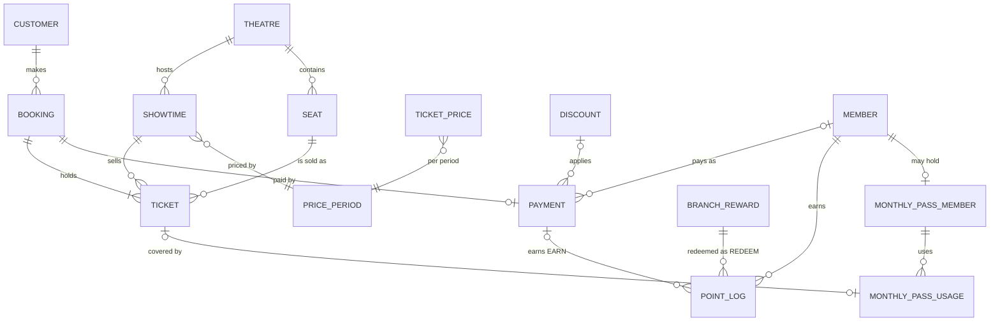

# Cinema Booking Database

[](https://github.com/SirapraphatS/cinema-booking-db/actions/workflows/test.yml)


A cinema booking database for PostgreSQL where the business rules (seat holds, payment, coupons,
Monthly Pass, loyalty points) are enforced **inside the database** by stored procedures and verified by
68 automated tests.

## Table of contents

- [About](#about)
- [Features](#features)
- [Quick start](#quick-start)
- [Usage](#usage)
- [Data model](#data-model)
- [The five flows](#the-five-flows)
- [Business rules](#business-rules)
- [Tests](#tests)
- [Challenges and what I learned](#challenges-and-what-i-learned)
- [Limits and roadmap](#limits-and-roadmap)
- [Project structure](#project-structure)
- [More documentation](#more-documentation)
- [Credits and license](#credits-and-license)

## About

**What it is.** A 57-table relational design for a cinema chain (movies, branches, theatres,
showtimes, seats, ticket prices, members, coupons, bookings, payments, points, food) plus the
procedures that make bookings safe.

**Why I built it.** The design started as a group project for a university database-systems course
(presented in class on MySQL with phpMyAdmin). A design on paper does not show whether two people
can buy the same seat, whether points can go negative, or whether a half-failed booking leaves junk
behind, so I implemented the rules and tested them.

**What problem it solves.** Correctness under concurrency and failure: one place enforces the rules
for every client (app, script, future API), multi-row operations are all-or-nothing, and races are
closed where the data lives.

**What makes it stand out.** The behaviour is a specification of 68 `PASS`/`FAIL` checks that runs
in CI, a race test fires simultaneous sessions at one seat, and the design decisions (database
choice, composite vs surrogate keys, indexing) are written down with measurements, not opinions.

## Features

- Hold seats for 15 minutes without ever selling a seat twice
- Pay with a coupon (percent, amount or fixed price; date, branch and usage-limit checks) or an Monthly Pass
- Earn loyalty points on tickets (1 point per baht paid, 12-month expiry) and redeem them for rewards
  without the balance going negative
- Automatic release of expired holds, and cancellation of pending bookings
- Guest bookings (no account) and food items on the same booking
- Reproducible time: every procedure takes the clock as a parameter

## Quick start

Needs Docker and the `psql` client.

```bash
git clone https://github.com/SirapraphatS/cinema-booking-db.git
cd cinema-booking-db
make test    # starts PostgreSQL 16, rebuilds the database, runs the 68 tests
```

Other commands: `make race` (10 sessions fight for one seat), `make up` / `make down`.
Without Docker, point the scripts at any PostgreSQL 16 server:

```bash
PGHOST=127.0.0.1 PGUSER=postgres PGPASSWORD=secret scripts/run-tests.sh
```

or load `sql/01_schema.sql`, `02_sample_data.sql`, `03_booking_procedures.sql` (then `sql/tests/booking_tests.sql` on a fresh database) with
`psql -f`. Docker connection used by `make`: `localhost:5433`, user `postgres`, password `dev`,
database `cinema_booking`. The password is for local development only.

## Usage

Every procedure takes the current time as `p_now`, so behaviour is deterministic and testable; a real
application passes `now()`. The sample showtimes are dated 2026-11-05, so the examples use a fixed
clock shortly before them. OUT values are `INOUT` parameters: pass `NULL`, the result comes back as a row.

```sql
-- hold seat 4 for customer 1 at the 14:00 show of theatre 1, branch 1
CALL sp_hold_seats(1, NULL, 1, 1, '2026-11-05', '14:00', '4', '2026-11-05 13:01:00', NULL);
--  p_booking_id
-- --------------
--             8

-- pay it as member 2 with coupon CARD50 (50% off the ticket)
CALL sp_pay_booking(8, 2, 'CARD50', 'PromptPay', '2026-11-05 13:03:00', NULL, NULL);
--  p_payment_id | p_amount
-- --------------+----------
--             7 |   120.00

-- spend 100 points on reward 1 at branch 1
CALL sp_redeem_reward(2, 1, 1, '2026-11-06 10:00:00', NULL);
```

A second customer trying seat 4 at the same show gets `Seat already taken for this showtime`.

## Data model

57 tables in four zones: movies, locations/showtimes/prices, customers/members/promotions, and
bookings/tickets/payments/points/food (plus `app_config` for the rule constants). The booking core:



Design points worth knowing:

* `ticket` has a 5-column primary key (branch, theatre, showtime date, showtime time, seat), so **the
  same seat in the same showtime can never be sold twice**, enforced by the database itself.
* A held seat is simply a `ticket` row of a `PENDING` booking with an expiry time.
* Prices come from `ticket_price` by branch + theatre type + seat type + dimension + price period
  + date range; the price paid is copied into `ticket.ticket_sale_price` at sale time.
* Loyalty points are a ledger (`EARN` positive, `REDEEM` negative); the balance is the sum, never
  stored twice.

## The five flows

| Flow | Procedure | What it does |
|---|---|---|
| Hold seats | `sp_hold_seats` | Validates showtime and seats, creates a `PENDING` booking (15 min hold), looks up prices, all-or-nothing |
| Pay | `sp_pay_booking` | Checks member, coupon or Monthly Pass; writes the payment, marks the booking `PAID`, earns points |
| Redeem points | `sp_redeem_reward` | Spends points on a branch reward; the balance can never go negative |
| Free expired holds | `sp_release_expired` | Deletes tickets of `PENDING` bookings past their expiry, marks them `EXPIRED` |
| Cancel | `sp_cancel_booking` | Cancels a `PENDING` booking and frees its seats |

Helpers: `fn_ticket_price`, `fn_discounted_price`, `fn_point_balance`, `fn_showtime_start`, `fn_config`.

## Business rules

Constants live in the `app_config` table.

* A hold lasts `HOLD_MINUTES` = 15.
* 1 point per baht actually paid on **tickets after the coupon** (food does not earn points); points
  expire after 12 months.
* One coupon per payment; it only reduces ticket prices (food is paid in full).
* Monthly Pass: one ticket per booking, once per movie; Normal 2D seats are free, other seats pay only the
  difference to the Normal 2D price; country and genre exclusions come from `member_type_condition`.
* Showtimes starting before 04:00 belong to the previous business day.

## Tests

`sql/tests/booking_tests.sql` prints one `PASS`/`FAIL` line per check and exits non-zero on any failure:

```
PASS price: Normal seat, Thursday 2D = 240
PASS hold: a seat held by another unexpired booking is refused
PASS hold: one bad seat rejects the whole request
PASS pay: coupon reduces tickets only (240 - 20 + 125 food = 345)
PASS coupon: usage limit reached
PASS redeem: the balance never goes negative (50 left, cost 100)
PASS Monthly Pass: the same movie cannot be watched twice
...
68 passed, 0 failed
```

It covers price lookup, double-selling a seat, atomic rollback of a half-failed request, hold expiry
and cancellation, coupon rules (unknown, expired, wrong branch, usage limit), member checks, points
earned and redeemed, Monthly Pass rules, guests and food. `scripts/run-race-test.sh` starts N
simultaneous sessions on one seat and checks for exactly one winner. Both run in GitHub Actions on
every push.

## Challenges and what I learned

* **Races.** Check-then-act logic fails when two sessions run at once. The fix is a constraint (the
  `ticket` key) plus row locks (`FOR UPDATE`), proven by the race test rather than assumed.
* **Atomicity and error handling.** PostgreSQL procedures run in the caller's transaction and an
  exception undoes the call; a sub-transaction (`BEGIN ... EXCEPTION`) translates a duplicate-key
  error into a clear message. I first built the same logic on MySQL 8 and chose PostgreSQL for this
  reason and others, see [docs/why-postgresql.md](docs/why-postgresql.md).
* **Indexing.** PostgreSQL does not index foreign keys automatically; I found 54 missing ones with a
  catalog query and added them.
* **Composite keys vs a surrogate id.** I measured both on 2.8 million tickets: indexes shrink a lot
  with an id but the hot queries are equally fast, and a bare id would lose a guarantee the composite
  key gives for free. Details in [benchmarks/](benchmarks/ticket-key-design/README.md).
* **Testing time.** Passing the clock as a parameter made expiry and validity windows testable.

## Limits and roadmap

Known limits:

* Points are a ledger, not first-in-first-out lots: a redemption never uses up a specific earned batch.
* Monthly Pass `MIN_GAP_MINUTES` (shows at least 2 hours apart) is stored in the data but not enforced.
* A showtime that already has tickets cannot be rescheduled (its date and time are part of its key).
* No application or API layer: the point of the project is the database.

Ideas for next steps:

* Prevent overlapping showtimes in one theatre with an exclusion constraint
* Give an application role `EXECUTE` on the procedures only (no direct table writes)
* Schedule `sp_release_expired` with `pg_cron`
* Allow rescheduling with `ON UPDATE CASCADE` or a `showtime_id`

## Project structure

```
sql/
  01_schema.sql                 57 tables + app_config + indexes
  02_sample_data.sql            fictional sample data
  03_booking_procedures.sql     the five flows and their helper functions
  tests/booking_tests.sql       the 68 checks
scripts/
  run-tests.sh                  rebuild the database and run the tests
  run-race-test.sh              simultaneous sessions fight for one seat
benchmarks/ticket-key-design/   composite key vs surrogate id, measured on 2.8 M tickets
docs/                           why-postgresql.md, procedure-walkthrough.md, design-decisions.md
docker-compose.yml, Makefile, .github/workflows/test.yml
```

## More documentation

- [docs/why-postgresql.md](docs/why-postgresql.md): advantages of database-side rules, and why PostgreSQL
- [docs/procedure-walkthrough.md](docs/procedure-walkthrough.md): how each procedure works and why, with exercises
- [docs/design-decisions.md](docs/design-decisions.md): schema differences, locks, trade-offs, known limits
- [README.th.md](README.th.md): short summary in Thai

## Credits and license

Group project for a university database-systems course; the implementation, tests and documentation
were extended by [@SirapraphatS](https://github.com/SirapraphatS). Movie and people data are
fictional. Contributions are not being sought for this portfolio project.

Released under the MIT License, see [LICENSE](LICENSE).
