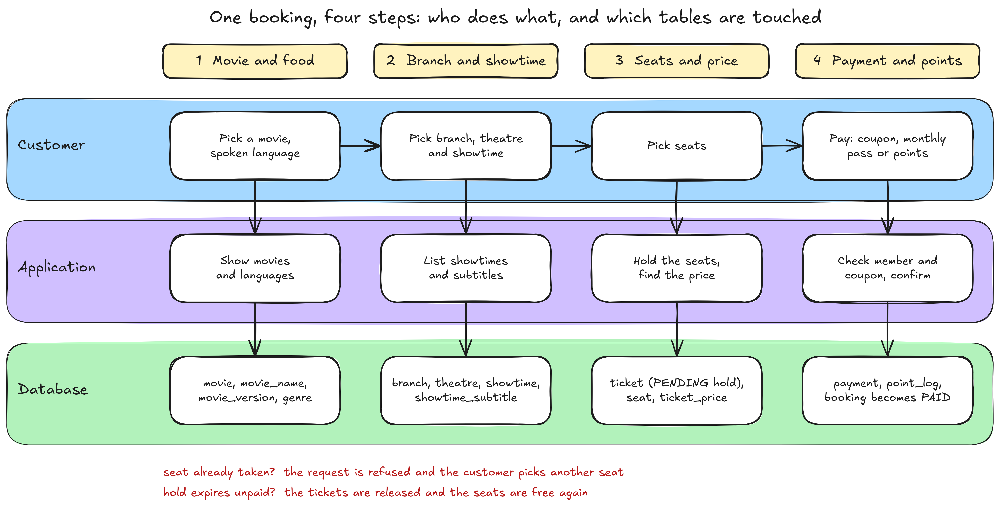
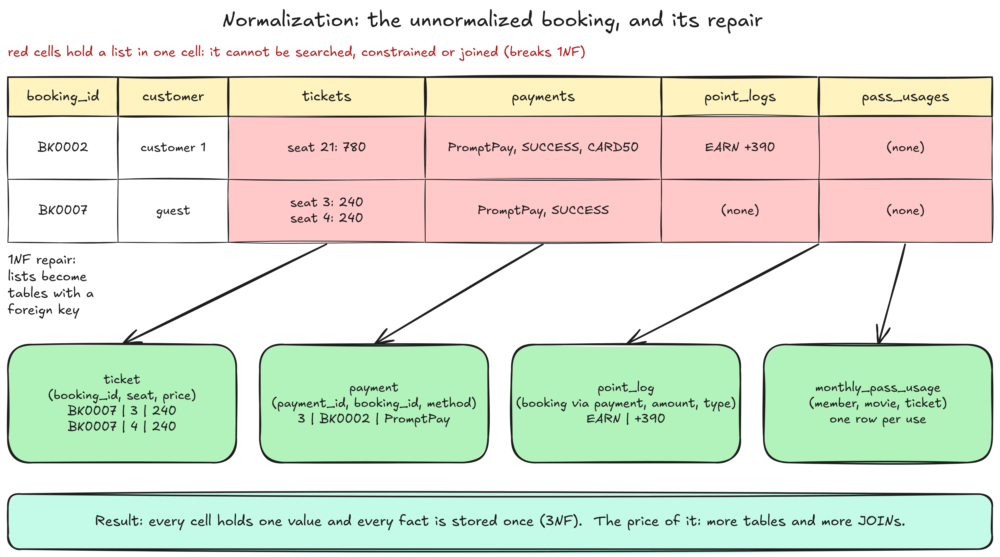

# The story of this project: from coursework to implementation

This is the narrative behind the repository: what we were asked to build in a database course, why
the design looks the way it does, where the course toolbox ran out, and why the second stage
(PostgreSQL) was needed and built the way it was. It is written as scenes. Folder and file names
refer to this repository: `design-mysql/` is stage 1, `sql/` is stage 2.

Contents

- [Prologue: the assignment and its toolbox](#prologue-the-assignment-and-its-toolbox)
- [Scene 1: choosing the domain](#scene-1-choosing-the-domain)
- [Scene 2: from a customer's journey to 57 entities](#scene-2-from-a-customers-journey-to-57-entities)
- [Scene 3: normalization as the design method](#scene-3-normalization-as-the-design-method)
- [Scene 4: zone by zone, why each table exists](#scene-4-zone-by-zone-why-each-table-exists)
- [Scene 5: where the course toolbox ran out](#scene-5-where-the-course-toolbox-ran-out)
- [Scene 6: the decision to implement](#scene-6-the-decision-to-implement)
- [Scene 7: how the implementation was built, and what changed](#scene-7-how-the-implementation-was-built-and-what-changed)
- [Epilogue: what I would do next](#epilogue-what-i-would-do-next)

## Prologue: the assignment and its toolbox

The brief was a group project for a database-systems course: pick a real organisation, analyse
how its system works, design the database, normalize it, and present it. The instructor also set a
checklist for the final presentation: slides made for presenting (little text), a swimlane workflow
diagram, a starting point for normalization with real data, the ER diagram before and after
normalization with a conclusion, references, and the same structure and colours throughout.

What matters for this story is the **toolbox the course had given us at that point**, because the
design is shaped by it. Based on our notes of what had been taught:

| Taught and used | Not taught yet, so not used |
|---|---|
| Entities, attributes, relationships and cardinalities (1:1, 1:M, M:N) | `UNIQUE`, `CHECK` constraints, triggers |
| `PRIMARY KEY`, `FOREIGN KEY`, `NOT NULL`, data types, **composite keys** and composite foreign keys | views (`CREATE VIEW`) |
| Normalization from unnormalized (UNF) to **1NF, 2NF and 3NF** | `GROUP BY`, `SUM`, `COUNT` (aggregates) |
| SQL: `SELECT`, `JOIN` (inner, and left in one example), `WHERE`, `ORDER BY`, `LIKE` | `CASE`, `COALESCE`, `ROUND` |

(The vocabulary of weak entities, role-playing foreign keys and candidate keys had not been taught
either, so the design does not use those words.) The schema header of the course design says it
plainly: only primary keys, foreign keys, `NOT NULL` and data types. One `UNIQUE` slipped into the
file, on the ticket columns of the monthly-pass usage table (a ticket can use the benefit at most
once), an exception we kept. Two further patterns appear in the design, a specialization
(`monthly_pass_member`) and a recursive M:N (`product_set`); the notes do not record that they were
taught, so they are described here as design choices, not as course content.

Everything in the next scenes, and every limitation in Scene 5, follows from this table.

## Scene 1: choosing the domain

We chose a Thai cinema chain because its system touches every kind of data a database course wants:
people (customers, members), places (branches, theatres, seats), time (showtimes, price periods),
money (tickets, food, coupons, points) and rules (membership conditions). The facts came from the
chain's public annual report, not from guesses. All people, movies and amounts in the sample data
are fictional.

A booking in the real system has four steps: pick the movie and food, pick the branch and
showtime, pick the seats, pay and earn points. We kept that order as the spine of the whole project
and later drew it as swimlane diagrams (customer / application / database). Three design goals
were written down at the start and checked at the end:

1. store the data of every booking step (57 entities in 4 zones);
2. every entity reaches **3NF**: no several-values-in-one-cell, and each fact stored once;
3. cross-table questions can be answered with SQL `JOIN`s.

## Scene 2: from a customer's journey to 57 entities

Before drawing any table we followed one imaginary customer through a booking, split into before
booking, during booking, payment and after payment, and wrote down the questions the customer would ask: which
movies are on and in which language, is the seat free, how much is it, can I use my monthly pass,
did the payment succeed, did I earn points. Every **noun** in those questions became a candidate
entity: customer, member, movie, seat, showtime, ticket, payment, point log, food.

The four booking steps, who is involved in each, and the tables they touch:

Refining the candidates produced **57 entities in four zones**, colour-coded in our diagrams:

| Zone | Entities | What it covers |
|---|---|---|
| 1. Movies | 14 | titles in several languages, genres, credits, versions by audio language, media, re-releases |
| 2. Locations, showtimes, prices | 13 | branches, theatres, seats, showtimes, subtitles, price periods, ticket prices |
| 3. Customers, members, promotions | 17 | customers, membership types and conditions, registrations, cards, news, rewards, coupons |
| 4. Booking, tickets, payment, points, food | 13 | bookings, tickets, payments, point ledger, monthly-pass usage, products |

Zones kept the work divisible among six people and kept each ER diagram small enough to read. The
booking core, with the four zones colour-coded:

## Scene 3: normalization as the design method

We did not draw the final tables first. For each zone we wrote the **unnormalized** version the way
a beginner would: one wide table per concept, with lists inside cells (`genre_names`, `seats`,
`subtitles`, `ticket_prices`, `favorite_branches`, `tickets`, `payments`...). Then we repaired it step
by step, coloured the offending columns, and drew the ER after each repair. The rules we applied:

- **1NF**: a cell holds one value. A list in a cell (`genre_names = "Action; Sci-Fi"`) cannot be searched
  or constrained, so each list became a table (usually the middle table of an M:N relationship).
- **2NF**: every non-key column depends on the **whole** key. When the key is composite, a column
  that depends on only part of it belongs elsewhere. `movie_runtime` is the clearest case: the
  Thai dub of a movie runs 152 minutes and the English one 148, so the runtime depends on
  `(movie_id, audio_language_id)`, not on the movie alone. It lives in `movie_version`.
- **3NF**: a column depends on the key and nothing but the key. `branch_address` depends on the
  branch, `partner_logo` on the partner, so each moved to its own table instead of being repeated
  wherever the name appears.
- A fourth rule we added for ourselves: even when a column passes 1NF, **free text that people could
  type differently** (a status, a size, a language name) becomes a lookup table referenced by a
  foreign key, so a typo cannot create a second spelling.

The same repair on the heart of the system, the booking:

The conclusion we presented with every zone: after the repairs every entity is in 3NF, and the
cost is more tables and more `JOIN`s, which is exactly what SQL is for.

## Scene 4: zone by zone, why each table exists

Each subsection lists the problem found in the unnormalized version, the table that fixed it, and
the reason. Table names are those of `design-mysql/01_schema_design.sql`.

### Zone 1: movies

| Problem | Design | Why |
|---|---|---|
| `genre_names` held several genres | `genre` + `movie_genre` | M:N: a movie has several genres and a genre has many movies. Movie A is Action and Sci-Fi: two rows |
| a movie has a title per language | `movie_name (movie_id, language_id)` | one row per language, composite key |
| runtime differs by audio language | `movie_version (movie_id, audio_language_id)` carries `movie_runtime` | the 2NF case above |
| a person can be director and actor of the same film | `movie_credit (movie_id, person_id, role_id)` | `role_id` is **part of the key**, so one person can hold several roles in one movie |
| rating group repeated as text | `rate` | change a name once, in one row |
| files and file types | `media` + `media_format`, `movie_media` | a movie has many files; the format (image/video) is a lookup |
| a movie can be re-released several times | `movie_rerelease (movie_id, number)` | repeating group turned into rows |

### Zone 2: locations, showtimes, prices

| Problem | Design | Why |
|---|---|---|
| address depended on the branch name | `branch` | 3NF |
| theatre type, sound system, screen kind as text | `theatre_type`, `sound_system`, `screen_format` | lookups instead of retyped text |
| `seats` held many seats in one cell | `seat (branch, theatre, seat_id)` + `seat_type` | **a seat is never deleted or renumbered**: removing a seat sets `seat_status = 'REMOVED'`, and the replacement gets a new `seat_id` (sample data: seat 1, A1, is removed; seat 21 is a new pair seat at the same position). Old tickets keep pointing at a row that still exists |
| several subtitle languages per showtime | `showtime_subtitle` | the instructor asked for several subtitles on one showtime. No row means no subtitles |
| prices depend on branch, theatre type, seat type, 2D/3D, time band and date | `price_period` + `ticket_price` with a composite key ending in a start date | when a price changes we **add a row** with a new start date; the old price stays for old showtimes |
| a showtime after midnight belongs to the previous business day | rule recorded on `showtime` | a 00:30 show is stored under the day it started; the price period uses that day |

The pricing design was rewritten once. The first version had a base-price table plus separate
adjustment and final-price tables. The final `ticket_price` answers "how much is this seat?" with one
lookup, and each ticket stores `ticket_sale_price`, the price **actually charged**.

### Zone 3: customers, members, promotions

| Problem | Design | Why |
|---|---|---|
| `favorite_branches` list | `favorite_branch (customer, branch)` | M:N middle table |
| membership rules as a list in one cell | `member_type` + `member_type_condition` | rules such as one viewing per movie, 120 minutes between shows, allowed seat type, excluded genres are data rows, not code |
| "asked for membership" vs "is a member" | `register` and `member` | a customer can register several times over the years (Somying: a regular membership, then a monthly pass); each approval is a `member` row with its own start and end date. History is kept |
| lost membership cards | `member_card (member_id, issue_date)` | a member may hold several cards over time; no row means an app-only member. There is **no end-date column**: the status (`ACTIVE` / `CANCELLED`) never depends on another non-key column, so the table stays 3NF |
| monthly pass is a special kind of member | `monthly_pass_member` (PK and FK to `member`) | **specialization**: only members listed here can use the monthly-pass benefit, and the database rejects others |
| news a customer saw | `customer_news` | who, which news, which branch, when, how they responded |
| a reward's point cost differs by branch | `reward` + `branch_reward (reward, branch, cost)` | the cost depends on **both** reward and branch, so it lives in the middle table |
| a reward tied to specific movies | `movie_reward` | a generic reward (free popcorn) simply has no row here |
| `partner_logo` depended on the partner name | `partner` + `discount` | 3NF |
| a coupon valid at several branches / in several news items | `discount_branch`, `discount_news` | M:N middle tables |

### Zone 4: booking, tickets, payment, points, food

| Problem | Design | Why |
|---|---|---|
| a `booking` held its tickets, payments, points and pass usage as lists | `ticket`, `payment`, `point_log`, `monthly_pass_usage` | the heart of the 1NF repair |
| the same seat must never be sold twice for one showtime | `ticket` primary key = (branch, theatre, showtime date, showtime time, seat) | the **database itself** refuses a duplicate. The foreign keys to `showtime` and to `seat` **share** the branch and theatre columns, so a ticket cannot point at a seat of another theatre |
| a guest books without an account | `booking.customer_id` may be empty; `booking_phone_number` is `NOT NULL` | every booking has a contact number (typed by the guest, or copied from the account) |
| a seat must be held while someone pays | a held seat is a `ticket` row of a booking with status `PENDING` and an expiry time | no separate "hold" table; if the hold expires unpaid, the ticket row goes away |
| payment amount | **not stored** | it is derived: tickets after the coupon plus food. Storing it would store the same fact twice |
| loyalty points | `point_log` as a **ledger**: `EARN` positive, `REDEEM` negative | the balance is the sum of the rows (390 earned, 100 redeemed: 290). A stored balance column would have to be kept in step with the ledger |
| monthly-pass rules | `monthly_pass_usage` primary key = (member, movie) | the key itself says "once per movie" |
| food: sizes, flavours, combos, branch prices | `size`, `flavor`, `product_flavor` (extra price per item), `product_set` (a **recursive M:N**: a combo is made of products), `product_price` with start and end dates, `booking_product` storing the **sale price at order time** | changing a product price later must not change old orders |

## Scene 5: where the course toolbox ran out

With only keys, `NOT NULL`, types and basic `SELECT`/`JOIN`, a design can describe **structure**
very well. It cannot state or enforce **behaviour**. Going through the design, the team's own
comments in the schema file mark these gaps, each one handed to "the application":

| Rule | In the course design | Who has to enforce it | Why that is a gap |
|---|---|---|---|
| a seat is sold once per showtime | the `ticket` key | the database | **covered**, thanks to the composite key |
| a ticket's seat belongs to the showtime's theatre | shared columns in two composite foreign keys | the database | **covered** (a deliberate trick) |
| a monthly pass is used once per movie, only by pass members | PK of `monthly_pass_usage`, FK to `monthly_pass_member` | the database | **covered** |
| booking, payment and points are written together | three separate inserts | the application | no `CHECK`, no trigger, and nothing in the design says these writes belong together: a crash in the middle can leave a paid booking without points |
| a hold expires after N minutes and frees the seat | `booking_expire_datetime` is stored | the application deletes the ticket | nothing in the database acts on a clock |
| coupon valid today, at this branch, within its usage limit | data columns exist | the application | no constraint can compare the dates or count previous uses |
| the points balance never goes negative | a ledger | the application | checking "balance >= cost" and inserting must be one step; without locking two requests can both pass |
| the ticket price for a seat | `ticket_price` rows | the application | the lookup joins six tables |
| the monthly-pass difference price, expiry of points | described in comments; `point_log_expired_date` column exists | the application | the column exists, the rule does not |
| the amount to pay and the points balance | derived | `SELECT` with `SUM` and `GROUP BY` | **not taught yet.** We first used a view, then removed it (views were not taught), then rewrote the slide queries to list rows and add by hand, or to filter by name instead of by id |

Two honest consequences:

- The presented SQL stayed small on purpose: every example on the slides used only `SELECT`, `JOIN`,
  `WHERE`, `ORDER BY` and `LIKE`. The extra statistics in `design-mysql/03_example_queries.sql`
  use aggregates and are marked as a later topic.
- The design was right about **structure** and silent about **behaviour**. That silence is the
  motivation for stage 2.

## Scene 6: the decision to implement

After the presentation the question changed from "is the design normalized?" to "does it behave?".
Normalization says nothing about two customers clicking the same seat in the same second, a
payment that fails after the points were written, or points spent twice. We could have written
that in an application, but then every future client (web app, admin script, API) would need to
repeat it, and one bug would sell a seat twice.

So we decided to implement the rules **inside the database**, as stored procedures with automated tests.
The arguments (details in [why-postgresql.md](why-postgresql.md)):

- one enforcement point for every client;
- all-or-nothing multi-row operations (a failed booking leaves nothing behind);
- races closed next to the data, with a constraint plus row locks;
- fewer round trips;
- the behaviour becomes a testable specification that runs in CI.

The seat rule in action: two sessions race for the same seat, and the key decides.

**Why PostgreSQL, not MySQL.** The course ran on MySQL, so we first wrote the same logic and the
same tests for both MySQL 8 and PostgreSQL 16. PostgreSQL won on things we actually observed:
procedures run inside the caller's transaction and an exception undoes the whole call; a duplicate-key
error can be translated without losing earlier work; under a race test of 10 to 12 simultaneous
sessions fighting for one seat, PostgreSQL always returned a clean "seat taken", while MySQL
occasionally aborted a session with a deadlock error. The MySQL port was dropped, the course version
stays on MySQL in `design-mysql/`, and the reasons are written down in
[why-postgresql.md](why-postgresql.md).

## Scene 7: how the implementation was built, and what changed

**The 57 tables did not change.** That is the best evidence that the structure was sound. Only four
things differ between `design-mysql/01_schema_design.sql` and `sql/01_schema.sql`:

1. `booking_id`, `payment_id`, `point_log_id` are generated by the database, so two simultaneous
   bookings cannot invent the same id;
2. a small `app_config` table holds the rule constants (hold minutes, points per baht, points expiry,
   business-day cutoff) instead of burying numbers in code;
3. an index for every foreign key, because PostgreSQL does not create them (54 were missing);
4. comments in English.

**The five flows** map to the four booking steps of Scene 1: hold seats, pay (coupon, monthly pass,
points earned), redeem points, free expired holds, cancel. Each flow answers a row of the gap table in Scene 5:

| Gap in Scene 5 | Implementation |
|---|---|
| booking, payment and points written together | one procedure, one transaction: it all happens or none of it does |
| hold expiry | `sp_release_expired`, and `sp_hold_seats` frees lapsed holds before it books |
| coupon rules | checked inside `sp_pay_booking` (code exists, dates, branch, usage limit), the coupon row locked while counting |
| negative points | `sp_redeem_reward` locks the member row, compares the balance, then writes |
| the six-table price lookup | `fn_ticket_price`, tested against the sample prices (240 and 780) |
| amount and balance | computed in the procedures and `fn_point_balance`; aggregates are fine now, the course limit no longer applies |

**Design decisions made on the way**, each with its reasoning in
[design-decisions.md](design-decisions.md):

- The points rate was read from the data, not invented: the sample data already showed a 780 ticket with
  a 50% coupon earning 390 points, which fixes it at one point per baht actually paid (food excluded).
  The other constants are settings in `app_config`: the 15-minute hold is our choice (the sample
  bookings used 10-minute holds) and the 12-month points expiry follows the sample data's expiry dates.
- Every procedure takes the clock as a parameter (`p_now`), so expiry and validity windows are
  testable without waiting.
- We kept the **composite keys** of the course design. Measured on 2.8 million tickets
  ([benchmarks](../benchmarks/ticket-key-design/README.md)), a surrogate id shrinks the indexes a lot
  but the hot queries are equally fast, and a bare id would lose the guarantee that a ticket's seat
  belongs to its showtime's theatre. The one real argument for an id is rescheduling a showtime, listed
  as a known limit.
- **68 tests** state each rule as an assertion (a held seat cannot be booked again, one bad seat rejects
  the whole request, the balance never goes negative, a coupon past its limit is refused, and so on),
  and a **race test** starts simultaneous sessions on one seat and expects exactly one winner. Both
  run in CI on every push.

**What the implementation found that the paper design could not.** Building the logic exposed
questions the design had left open: what exactly a hold is (a ticket row, so expiry must delete it),
what counts for points (ticket price after the coupon, not food), whether a failed payment of an
expired hold should release the seats (it cannot, inside one failing call), and that PostgreSQL does
not index foreign keys on its own. Each is written down rather than left implicit.

## Epilogue: what I would do next

Known limits and next steps are listed in the [README](../README.md#limits-and-roadmap). In story
terms:

- points are a ledger, not first-in-first-out lots, so expiry is approximate;
- the monthly pass condition "shows at least two hours apart" is stored but not enforced;
- a showtime that already has tickets cannot be rescheduled without an id or a cascading update;
- an exclusion constraint could forbid overlapping showtimes in one theatre, something the course
  toolbox could never have expressed;
- an application role could be given `EXECUTE` on the procedures only, so even a compromised
  application cannot write inconsistent rows.

The arc in one sentence: the course design made the structure **correct**; the implementation made the
behaviour **safe**, without having to change the structure.
