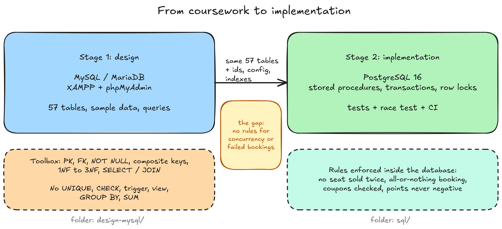
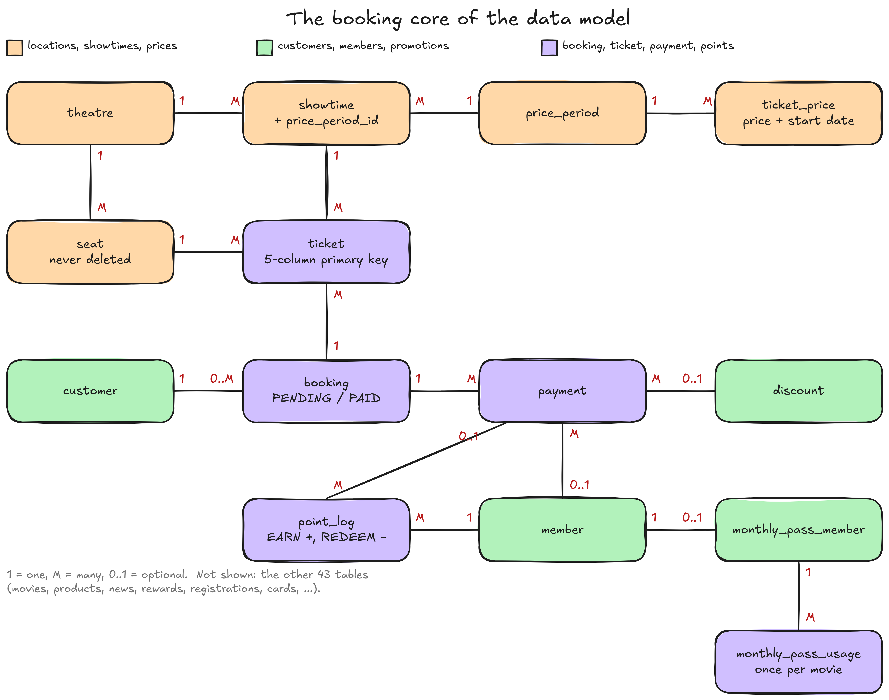
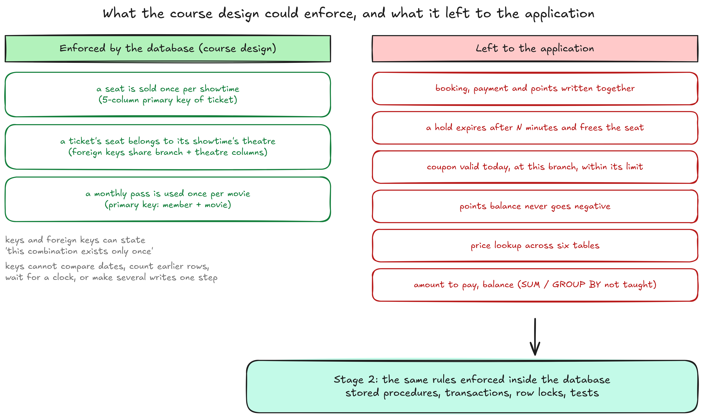
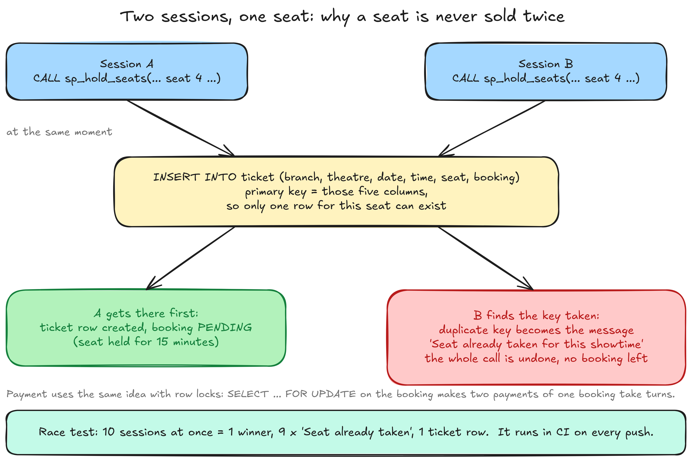

# From coursework to implementation

This project started as a database-systems course assignment and became a PostgreSQL implementation. This page follows that path in order: what the course asked for, why the design looks the way it does, where the course toolbox ran out, and what we built next. `design-mysql/` holds stage 1 and `sql/` holds stage 2.

- [Prologue: the assignment and its toolbox](#prologue-the-assignment-and-its-toolbox)
- [Scene 1: choosing the domain](#scene-1-choosing-the-domain)
- [Scene 2: from a customer's journey to 57 entities](#scene-2-from-a-customers-journey-to-57-entities)
- [Scene 3: normalization](#scene-3-normalization)
- [Scene 4: why each table exists](#scene-4-why-each-table-exists)
- [Scene 5: where the course toolbox ran out](#scene-5-where-the-course-toolbox-ran-out)
- [Scene 6: deciding to implement](#scene-6-deciding-to-implement)
- [Scene 7: building the implementation](#scene-7-building-the-implementation)
- [Epilogue: what comes next](#epilogue-what-comes-next)

## Prologue: the assignment and its toolbox

The brief was a group project: pick a real organisation, work out how its system runs, design the database, normalize it and present it. The instructor's checklist for the final presentation asked for slides with little text, a swimlane workflow diagram, a starting point for normalization with real data, the ER diagram before and after normalization with a conclusion, references, and the same structure and colours throughout.

The design follows from what the course had taught at that point. This is what our notes say:

| Taught and used | Not taught yet, so not used |
|---|---|
| Entities, attributes, relationships and cardinalities (1:1, 1:M, M:N) | `UNIQUE`, `CHECK` constraints, triggers |
| `PRIMARY KEY`, `FOREIGN KEY`, `NOT NULL`, data types, composite keys and composite foreign keys | views (`CREATE VIEW`) |
| Normalization from unnormalized (UNF) to 1NF, 2NF and 3NF | `GROUP BY`, `SUM`, `COUNT` (aggregates) |
| SQL: `SELECT`, `JOIN` (inner, and left in one example), `WHERE`, `ORDER BY`, `LIKE` | `CASE`, `COALESCE`, `ROUND` |

Weak entities, role-playing foreign keys and candidate keys had not been taught either, so the design does not use those words. The schema header of the course design lists only primary keys, foreign keys, `NOT NULL` and data types. One `UNIQUE` slipped in anyway, on the ticket columns of the monthly-pass usage table (a ticket can use the benefit at most once), and we kept it. The design also contains a specialization (`monthly_pass_member`) and a recursive M:N (`product_set`). Our notes do not say whether the course taught them, so we describe them as our own design choices.

## Scene 1: choosing the domain

We picked a Thai cinema chain because its system covers most of what a database course likes to use: people (customers, members), places (branches, theatres, seats), time (showtimes, price periods), money (tickets, food, coupons, points) and rules (membership conditions). The facts came from the chain's public annual report. The people, movies and amounts in the sample data are made up.

A booking in the real system has four steps: pick the movie and food, pick the branch and showtime, pick the seats, then pay and earn points. We used that order as the spine of the project and later drew it as swimlanes (customer, application, database). We wrote three design goals at the start and checked them at the end:

1. Store the data of every booking step (57 entities in 4 zones).
2. Bring every entity to 3NF: one value per cell, each fact stored once.
3. Answer cross-table questions with SQL `JOIN`s.

## Scene 2: from a customer's journey to 57 entities

Before drawing any table we followed one imaginary customer through a booking (before booking, during booking, payment, after payment) and wrote down the questions they would ask: which movies are on and in which language, is the seat free, how much is it, can I use my monthly pass, did the payment go through, did I earn points. Every noun in those questions became a candidate entity: customer, member, movie, seat, showtime, ticket, payment, point log, food.

The four steps, who does what in each, and the tables they touch:

Refining the candidates gave 57 entities in four zones, colour-coded in our diagrams:

| Zone | Entities | What it covers |
|---|---|---|
| 1. Movies | 14 | titles in several languages, genres, credits, versions by audio language, media, re-releases |
| 2. Locations, showtimes, prices | 13 | branches, theatres, seats, showtimes, subtitles, price periods, ticket prices |
| 3. Customers, members, promotions | 17 | customers, membership types and conditions, registrations, cards, news, rewards, coupons |
| 4. Booking, tickets, payment, points, food | 13 | bookings, tickets, payments, point ledger, monthly-pass usage, products |

Zones let six people work in parallel and kept each ER diagram small enough to read. This is the booking core:

## Scene 3: normalization

We did not draw the final tables first. For each zone we wrote the unnormalized version the way a beginner would: one wide table per concept, with lists inside cells (`genre_names`, `seats`, `subtitles`, `ticket_prices`, `favorite_branches`, `tickets`, `payments`). Then we repaired it step by step, coloured the offending columns and redrew the ER after each repair. The rules we applied:

- 1NF: a cell holds one value. A list in a cell (`genre_names = "Action; Sci-Fi"`) cannot be searched or constrained, so each list became a table, usually the middle table of an M:N relationship.
- 2NF: every non-key column depends on the whole key. In a table with a composite key, a column that depends on only part of it belongs elsewhere. `movie_runtime` shows it best: the Thai dub of a movie runs 152 minutes and the English one 148, so the runtime depends on `(movie_id, audio_language_id)` and not on the movie alone. It lives in `movie_version`.
- 3NF: a column depends on the key and nothing else. `branch_address` depends on the branch and `partner_logo` on the partner, so each moved to its own table instead of repeating wherever the name appears.
- Our own fourth rule: free text that people could type differently (a status, a size, a language name) becomes a lookup table behind a foreign key, even when the column already passes 1NF. A typo then cannot create a second spelling.

The same repair applied to the booking:

For every zone we concluded the same thing: all entities reach 3NF, at the price of more tables and more `JOIN`s.

## Scene 4: why each table exists

Each table below lists the problem found in the unnormalized version, the table that fixed it, and why. Names come from `design-mysql/01_schema_design.sql`.

### Zone 1: movies

| Problem | Design | Why |
|---|---|---|
| `genre_names` held several genres | `genre` + `movie_genre` | M:N: a movie has several genres and a genre has many movies. Movie A is Action and Sci-Fi: two rows |
| a movie has a title per language | `movie_name (movie_id, language_id)` | one row per language, composite key |
| runtime differs by audio language | `movie_version (movie_id, audio_language_id)` carries `movie_runtime` | the 2NF case above |
| a person can be director and actor of the same film | `movie_credit (movie_id, person_id, role_id)` | `role_id` is part of the key, so one person can hold several roles in one movie |
| rating group repeated as text | `rate` | change a name once, in one row |
| files and file types | `media` + `media_format`, `movie_media` | a movie has many files; the format (image or video) is a lookup |
| a movie can be re-released several times | `movie_rerelease (movie_id, number)` | repeating group turned into rows |

### Zone 2: locations, showtimes, prices

| Problem | Design | Why |
|---|---|---|
| address depended on the branch name | `branch` | 3NF |
| theatre type, sound system and screen kind as text | `theatre_type`, `sound_system`, `screen_format` | lookups instead of retyped text |
| `seats` held many seats in one cell | `seat (branch, theatre, seat_id)` + `seat_type` | a seat is never deleted or renumbered. Removing a seat sets `seat_status = 'REMOVED'` and the replacement gets a new `seat_id` (in the sample data seat 1, A1, is removed and seat 21 is a new pair seat in the same position). Old tickets keep pointing at a row that still exists |
| several subtitle languages per showtime | `showtime_subtitle` | the instructor asked for several subtitles on one showtime. No row means no subtitles |
| prices depend on branch, theatre type, seat type, 2D/3D, time band and date | `price_period` + `ticket_price` with a composite key ending in a start date | when a price changes we add a row with a new start date, and the old price stays for old showtimes |
| a showtime after midnight belongs to the previous business day | rule recorded on `showtime` | a 00:30 show is stored under the day it started, and the price period uses that day |

We rewrote the pricing once. The first version had a base-price table plus separate adjustment and final-price tables. The final `ticket_price` answers "how much is this seat?" with one lookup, and each ticket stores `ticket_sale_price`, the price actually charged.

### Zone 3: customers, members, promotions

| Problem | Design | Why |
|---|---|---|
| `favorite_branches` list | `favorite_branch (customer, branch)` | M:N middle table |
| membership rules as a list in one cell | `member_type` + `member_type_condition` | rules such as one viewing per movie, 120 minutes between shows, allowed seat type and excluded genres are data rows, not code |
| "asked for membership" versus "is a member" | `register` and `member` | a customer can register several times over the years (Somying: a regular membership, then a monthly pass). Each approval is a `member` row with its own start and end date, so history stays |
| lost membership cards | `member_card (member_id, issue_date)` | a member may hold several cards over time, and no row means an app-only member. There is no end-date column: the status (`ACTIVE` or `CANCELLED`) never depends on another non-key column, so the table stays 3NF |
| monthly pass is a special kind of member | `monthly_pass_member` (PK and FK to `member`) | specialization: only members listed here can use the monthly-pass benefit, and the database rejects anyone else |
| news a customer saw | `customer_news` | who, which news, which branch, when, how they responded |
| a reward's point cost differs by branch | `reward` + `branch_reward (reward, branch, cost)` | the cost depends on both reward and branch, so it lives in the middle table |
| a reward tied to specific movies | `movie_reward` | a generic reward (free popcorn) has no row here |
| `partner_logo` depended on the partner name | `partner` + `discount` | 3NF |
| a coupon valid at several branches and in several news items | `discount_branch`, `discount_news` | M:N middle tables |

### Zone 4: booking, tickets, payment, points, food

| Problem | Design | Why |
|---|---|---|
| a `booking` held its tickets, payments, points and pass usage as lists | `ticket`, `payment`, `point_log`, `monthly_pass_usage` | the main 1NF repair |
| one seat must never be sold twice for a showtime | `ticket` primary key = (branch, theatre, showtime date, showtime time, seat) | the database refuses a duplicate on its own. The foreign keys to `showtime` and to `seat` share the branch and theatre columns, so a ticket cannot point at a seat in another theatre |
| a guest books without an account | `booking.customer_id` may be empty; `booking_phone_number` is `NOT NULL` | every booking has a contact number, typed by the guest or copied from the account |
| a seat must be held while someone pays | a held seat is a `ticket` row of a booking with status `PENDING` and an expiry time | no separate hold table. If the hold expires unpaid, the ticket row goes away |
| payment amount | not stored | it is derived: tickets after the coupon plus food. Storing it would store the same fact twice |
| loyalty points | `point_log` as a ledger: `EARN` positive, `REDEEM` negative | the balance is the sum of the rows (390 earned, 100 redeemed, 290 left). A stored balance column would have to be kept in step with the ledger |
| monthly-pass rules | `monthly_pass_usage` primary key = (member, movie) | the key itself says "once per movie" |
| food: sizes, flavours, combos, branch prices | `size`, `flavor`, `product_flavor` (extra price per item), `product_set` (a recursive M:N: a combo is made of products), `product_price` with start and end dates, `booking_product` storing the sale price at order time | a later price change must not alter old orders |

## Scene 5: where the course toolbox ran out

Keys, `NOT NULL`, types and basic `SELECT` and `JOIN` describe structure well. They cannot state or enforce behaviour. Going through the design, the comments the team left in the schema file show where each rule was handed to "the application":

| Rule | In the course design | Who has to enforce it | Why that is a gap |
|---|---|---|---|
| a seat is sold once per showtime | the `ticket` key | the database | covered by the composite key |
| a ticket's seat belongs to the showtime's theatre | shared columns in two composite foreign keys | the database | covered |
| a monthly pass is used once per movie, only by pass members | PK of `monthly_pass_usage`, FK to `monthly_pass_member` | the database | covered |
| booking, payment and points are written together | three separate inserts | the application | no `CHECK`, no trigger, and nothing in the design says these writes belong together. A crash in the middle can leave a paid booking without points |
| a hold expires after N minutes and frees the seat | `booking_expire_datetime` is stored | the application deletes the ticket | nothing in the database acts on a clock |
| coupon valid today, at this branch, within its usage limit | data columns exist | the application | no constraint can compare dates or count earlier uses |
| the points balance never goes negative | a ledger | the application | checking "balance >= cost" and inserting must be one step. Without locking, two requests can both pass |
| the ticket price for a seat | `ticket_price` rows | the application | the lookup joins six tables |
| the monthly-pass difference price, expiry of points | described in comments; the `point_log_expired_date` column exists | the application | the column exists and the rule does not |
| the amount to pay and the points balance | derived | `SELECT` with `SUM` and `GROUP BY` | not taught yet. We first used a view, removed it because views were not taught, then rewrote the slide queries to list rows and add by hand, or to filter by name instead of by id |

Two things follow. The SQL we presented stayed small: every example on the slides used only `SELECT`, `JOIN`, `WHERE`, `ORDER BY` and `LIKE`. The extra statistics in `design-mysql/03_example_queries.sql` use aggregates and are marked as a later topic. And the design settled structure but said nothing about behaviour, which is the reason for stage 2.

## Scene 6: deciding to implement

After the presentation the question changed from "is the design normalized?" to "does it behave?". Normalization says nothing about two customers clicking the same seat in the same second, a payment that fails after the points were written, or points spent twice. We could have handled all that in an application, but every future client (web app, admin script, API) would then have to repeat the logic, and one bug would sell a seat twice.

So we put the rules inside the database, as stored procedures with automated tests. The reasons (details in [why-postgresql.md](why-postgresql.md)):

- one place enforces the rules for every client;
- multi-row operations are all-or-nothing, so a failed booking leaves nothing behind;
- a constraint plus row locks close races next to the data;
- fewer round trips;
- the behaviour becomes a specification that runs in CI.

Two sessions racing for the same seat, and the key deciding:

The course ran on MySQL, so we first wrote the same logic and the same tests for MySQL 8 and for PostgreSQL 16. PostgreSQL won on things we saw ourselves. Procedures run inside the caller's transaction and an exception undoes the whole call. A duplicate-key error can be translated without losing earlier work. In a race test of 10 to 12 simultaneous sessions fighting for one seat, PostgreSQL always returned a clean "seat taken", while MySQL sometimes aborted a session with a deadlock error. We dropped the MySQL port and left the course version on MySQL in `design-mysql/`. [why-postgresql.md](why-postgresql.md) has the full comparison.

## Scene 7: building the implementation

The 57 tables stayed as they were. Only four things differ between `design-mysql/01_schema_design.sql` and `sql/01_schema.sql`:

1. `booking_id`, `payment_id` and `point_log_id` are generated by the database, so two simultaneous bookings cannot invent the same id.
2. A small `app_config` table holds the rule constants (hold minutes, points per baht, points expiry, business-day cutoff) instead of burying numbers in code.
3. Every foreign key has an index, because PostgreSQL does not create them (a test checks this).
4. Comments are in English.

The five flows follow the four booking steps from Scene 1: hold seats, pay (coupon, monthly pass, points earned), redeem points, free expired holds, and cancel. Each one closes a gap from Scene 5:

| Gap in Scene 5 | Implementation |
|---|---|
| booking, payment and points written together | one procedure, one transaction: it all happens or none of it does |
| hold expiry | `sp_release_expired`, and `sp_hold_seats` frees lapsed holds before it books |
| coupon rules | checked inside `sp_pay_booking` (code exists, dates, branch, usage limit), with the coupon row locked while counting |
| negative points | `sp_redeem_reward` locks the member row, compares the balance, then writes |
| the six-table price lookup | `fn_ticket_price`, tested against the sample prices (240 and 780) |
| amount and balance | computed in the procedures and in `fn_point_balance`; aggregates are allowed now |

Decisions made along the way, each with its reasoning in [design-decisions.md](design-decisions.md):

- We read the points rate from the data. The sample data already showed a 780 ticket with a 50% coupon earning 390 points, which gives one point per baht paid (food excluded). The other constants are settings in `app_config`. The 15-minute hold is our choice, since the sample bookings used 10-minute holds, and the 12-month points expiry follows the expiry dates in the sample data.
- Every procedure takes the clock as a parameter (`p_now`), so expiry and validity windows can be tested without waiting.
- We kept the composite keys. On 2.8 million tickets ([benchmark](../benchmarks/ticket-key-design/README.md)) a surrogate id shrinks the indexes a lot, but the hot queries run equally fast, and a bare id would lose the guarantee that a ticket's seat belongs to its showtime's theatre. The one real argument for an id is rescheduling a showtime, which we list as a known limit.
- The tests state each rule as an assertion (a held seat cannot be booked again, one bad seat rejects the whole request, the balance never goes negative, a coupon past its limit is refused, and so on). A race test starts simultaneous sessions on one seat and expects exactly one winner. Both run in CI on every push.

Writing the logic also settled questions the design had left open: what a hold is (a ticket row, so expiry has to delete it), what earns points (ticket price after the coupon, not food), and whether a failed payment on an expired hold can release the seats (it cannot, because the failing call undoes everything it did). It also showed that PostgreSQL does not index foreign keys on its own.

## Epilogue: what comes next

The [README](../README.md#limits-and-roadmap) lists the known limits and next steps. In short:

- Points are a ledger, not first-in-first-out lots, so expiry is approximate.
- The monthly-pass condition "shows at least two hours apart" is stored but not enforced.
- A showtime that already has tickets cannot be rescheduled without an id or a cascading update.
- An exclusion constraint could forbid overlapping showtimes in one theatre, which the course toolbox could never express.
- An application role could get `EXECUTE` on the procedures only, so even a compromised application cannot write inconsistent rows.
